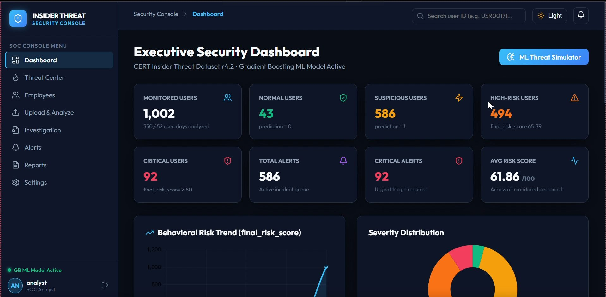
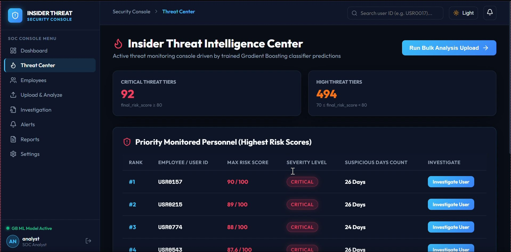
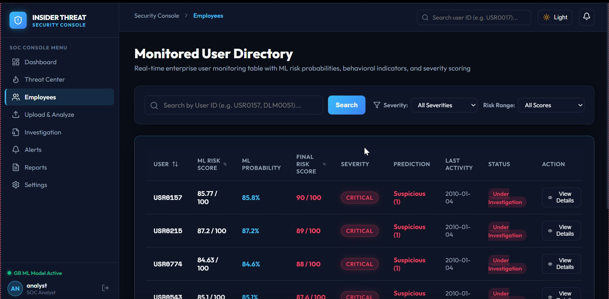
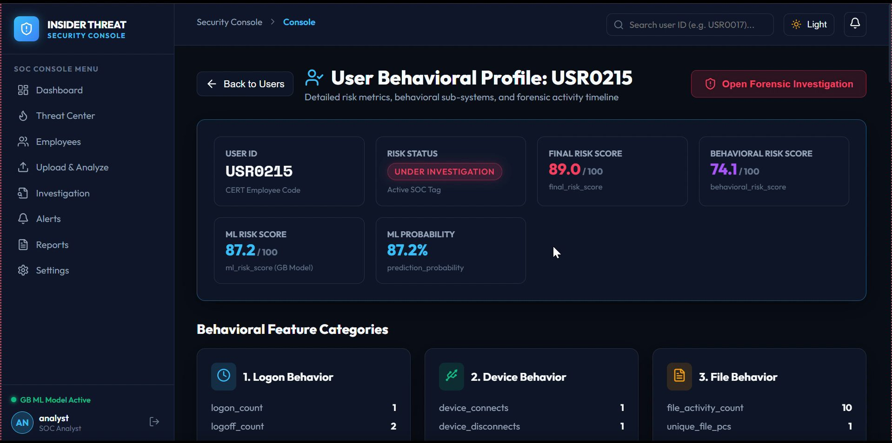
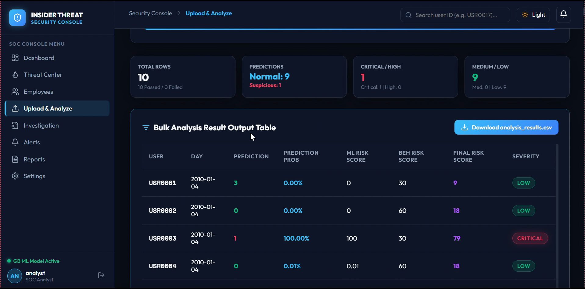
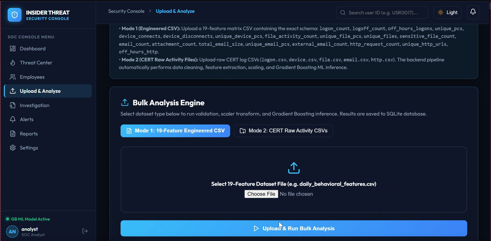
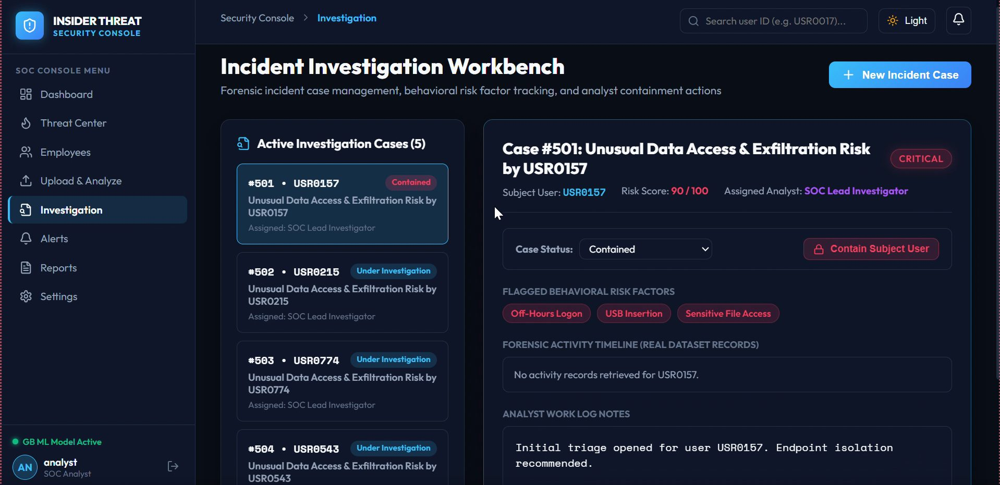
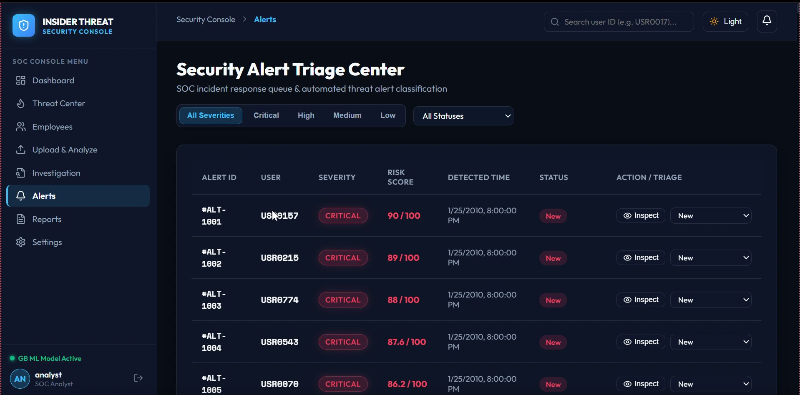
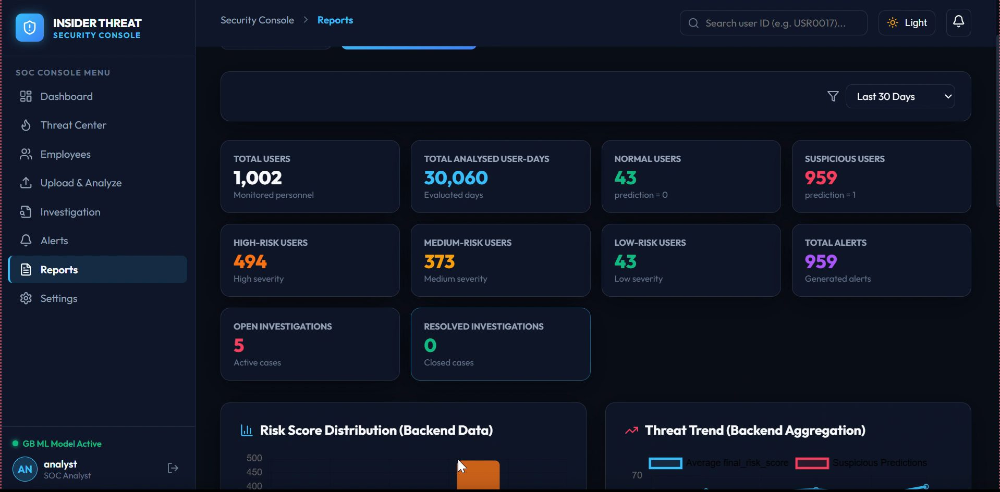
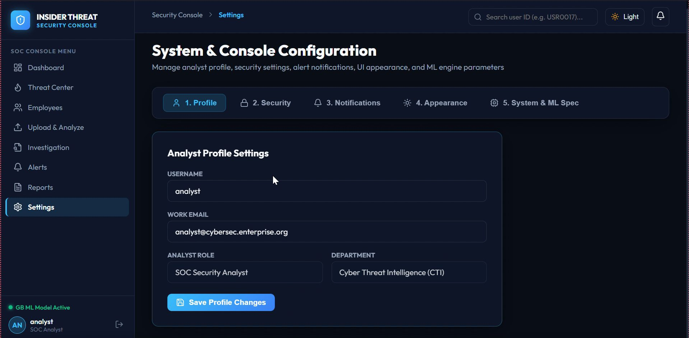

# Insider Threat Behavioral Intelligence System

A machine-learning-powered security console for analyzing employee activity patterns and identifying potentially suspicious insider behavior. The project combines behavioral feature analysis, Gradient Boosting classification, risk scoring, alert triage, and investigation workflows in a unified analyst interface.

> **Dataset note:** This project references the CERT Insider Threat Dataset (r4.2). Use only dataset files you are permitted to access and redistribute. Do not commit confidential, personal, or restricted source data.

## Application Preview

The screenshots below show the application's main interfaces.

### 1. Analyst Login


### 2. Executive Security Dashboard


### 3. Insider Threat Intelligence Center


### 4. Monitored Employee Directory


### 5. User Behavioral Profile


### 6. Bulk Analysis Results


### 7. Bulk Analysis Upload


### 8. Incident Investigation Workbench


### 9. Security Alert Triage Center


### 10. Reports and Analytics


### 11. System and Analyst Settings


## Key Features

- **Behavioral activity analysis:** Processes employee activity signals such as logon, device, file, email, and web/HTTP events.
- **Machine learning inference:** Uses a trained Gradient Boosting classifier to classify activity records.
- **Risk scoring:** Presents machine-learning and behavioral risk indicators in a consolidated risk view.
- **Threat monitoring:** Highlights users and activity patterns that may require further review.
- **Bulk analysis:** Supports an engineered 19-feature CSV workflow and a raw CERT activity CSV workflow, as presented in the interface.
- **Alert triage:** Displays alert severity, risk score, status, and analyst actions.
- **Investigation workflow:** Provides incident case tracking and a workspace for analyst notes and containment-related actions.
- **Reporting:** Summarizes monitored users, analyzed user-days, risk categories, alerts, and investigation metrics.
- **Analyst settings:** Includes profile, security, notification, appearance, and system/ML configuration sections.

## Machine Learning

The application interface identifies a Gradient Boosting model as its active classifier. The analysis workflow is designed around behavioral features derived from activity logs. The displayed risk metrics combine model-related and behavioral indicators.

Model performance should be reported here only after evaluating the final model on a clearly defined held-out test set. Do not treat dashboard demo figures as validated model accuracy.

## Dataset

The project is based on the CERT Insider Threat Dataset r4.2. The interface describes activity sources including:

- `logon.csv` — logon and logoff events
- `device.csv` — removable-device activity
- `file.csv` — file activity
- `email.csv` — email activity
- `http.csv` — web/HTTP activity
- Psychometric information, where applicable to the implemented pipeline

Check the dataset's original terms before sharing any raw files. Prefer documenting the expected input schema rather than committing the dataset itself.

## Technology Stack

Based on the project implementation, update this list to match the exact dependencies in the repository:

- Python
- Pandas and NumPy
- Scikit-learn
- Gradient Boosting Classifier
- CSV-based activity data processing
- Web-based analyst dashboard

## Repository Structure

The structure below is illustrative. Adjust it to match the actual folders in this repository.

```text
Insider-Threat-Behavioral-Intelligence-System/
├── screenshots/
│   ├── 01-login.png
│   ├── 02-dashboard.png
│   ├── 03-threat-center.png
│   └── ...
├── ml/
│   └── models/
├── README.md
└── requirements.txt
```

## Getting Started

1. Clone this repository:

   ```bash
   git clone https://github.com/YOUR-USERNAME/Insider-Threat-Behavioral-Intelligence-System.git
   cd Insider-Threat-Behavioral-Intelligence-System
   ```

2. Create and activate a Python virtual environment:

   ```bash
   python -m venv .venv
   ```

   Windows:

   ```bash
   .venv\Scripts\activate
   ```

   macOS/Linux:

   ```bash
   source .venv/bin/activate
   ```

3. Install dependencies (if `requirements.txt` is present):

   ```bash
   pip install -r requirements.txt
   ```

4. Follow the run instructions for the actual frontend and backend entry points in this repository. Add the exact commands here once confirmed.

## Security and Responsible Use

- This is a defensive security analytics project intended to support authorized security investigations.
- Use synthetic, anonymized, or properly authorized data for demonstrations.
- Never commit passwords, API keys, `.env` files, private employee data, or restricted datasets.
- Demo credentials shown in screenshots should not be reused in a deployed environment. Configure secure authentication before deployment.

## Author

**Sunil M C**  
B.Tech — Artificial Intelligence  
SRM Institute of Science and Technology

---

If you find this project interesting, feel free to explore the source code and application screenshots.
